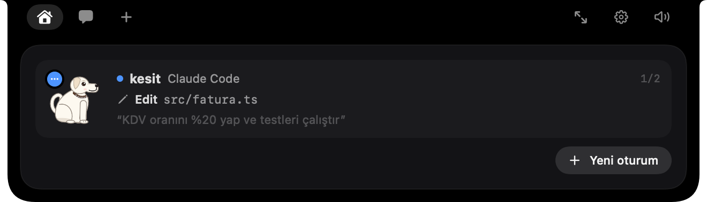

# Pepe

MacBook çentiğinde yaşayan bir köpek: Claude Code (ve Codex, Gemini, Copilot, OpenCode) oturumlarını çentikte gösterir,
izin ve soru kartlarını oradan cevaplatır, bitince haber verir. Yanında sohbet, sesli asistan ("OK Pepe"),
hatırlatmalar, haftalık özet ve GitHub / Stripe / Vercel / Trello gibi servisler için küçük kartlar ("pill") var.

Açık kaynak [Coucou](https://github.com/Louis-CFM/coucou)'dan ilham aldı; kod, karakter ve sesler bu projeye ait.

> Arayüz Türkçe. Kod içinde uygulamanın eski adı **Serce** (Serçe) olarak geçer.



## Gereksinimler

- macOS 14 (Sonoma) veya üstü. Çentikli MacBook'ta en iyi görünür; çentiksiz ekranda ekranın üst ortasında durur.
- Swift 5.9+ — Xcode 15+ ya da yalnızca Komut Satırı Araçları (`xcode-select --install`).
- [Claude Code](https://docs.claude.com/en/docs/claude-code) (isteğe bağlı ama asıl kullanım bu).

## Kurulum

```sh
git clone https://github.com/yerdekalmazer/pepe-arkadas.git
cd pepe-arkadas
./build.sh            # build/Pepe.app üretir
./build.sh --install  # /Applications/Pepe.app'e kurar ve açar
```

Apple Development sertifikan varsa uygulama onunla imzalanır; yoksa geçici (ad-hoc) imza kullanılır.
Belirli bir kimlik için: `SERCE_IMZA="<kimlik>" ./build.sh`.

Geliştirirken: `swift build && .build/debug/Serce`.

## İlk açılış

1. Menü çubuğundaki Pepe simgesi → **Ayarlar**.
2. **Claude Code → Bağla**: Pepe'nin hook'larını `~/.claude/settings.json` içine ekler (diğer hook'lara dokunmaz,
   önceki hali `settings.json.serce-yedek` olarak saklanır). Aynı yerden kaldırabilirsin.
3. Yeni bir terminalde `claude` başlat; oturum çentikte görünür.
4. Diğer ajanlar (Codex, Gemini, Copilot, OpenCode) için kurulum satırları Ayarlar'da.
5. Sohbet ve sesli asistan için Ayarlar'a bir Anthropic, OpenAI ya da Gemini anahtarı gir. Kartlar (GitHub, Stripe,
   Vercel, Trello, Cal.com, Resend, Notion, n8n…) yalnızca anahtarını girdiğin servislere bağlanır.

macOS ilk kullanımda mikrofon, konuşma tanıma, otomasyon (müzik çalar / Terminal kontrolü) ve ekran kaydı izni
isteyebilir; hepsi isteğe bağlı özellikler içindir.

## Gizlilik

- Hook sunucusu yalnızca `127.0.0.1:47823` üzerinde dinler ve rastgele bir jetonla korunur.
- Tüm veriler `~/Library/Application Support/Serce/` altında kalır. API anahtarları oradaki
  `anahtarlar.json` dosyasında, yalnızca senin okuyabildiğin (0600) izinle tutulur.
- Ağ isteği yalnızca anahtarını girdiğin servislere gider. Telemetri yok.

## Proje hafızası

Pepe her proje için `~/Library/Application Support/Serce/Hafiza/<proje>.md` dosyasında kısa bir hafıza tutar.
Proje kökü git deposundan bulunur; `Desktop`, `Documents`, `Projects` gibi kapsayıcı klasörler proje sayılmaz.
Kendi kategori klasörlerini eklemek için:

```sh
defaults write com.tahayerdekalmazer.serce kapsayiciKlasorler -array Isler Kisisel
```

## Klasörler

| Klasör | İçerik |
| --- | --- |
| `Sources/Serce` | Uygulama (SwiftPM, SwiftUI). Mimari notları: [MIMARI.md](MIMARI.md) |
| — | Tanıtım sayfası ayrı depoda: [pepe-landing](https://github.com/yerdekalmazer/pepe-landing) (gizli) |
| `reklam/` | Tanıtım videosu: HTML sahneler + `render.mjs` (Playwright) + `muzik.py` (sentez müzik) |

Ekran görüntülerini ekrana dokunmadan üretmek için: `build/Pepe.app/Contents/MacOS/Serce --snapshot <klasör>`.

## Lisans

[MIT](LICENSE)
